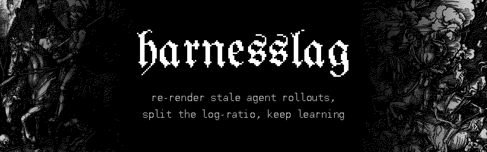
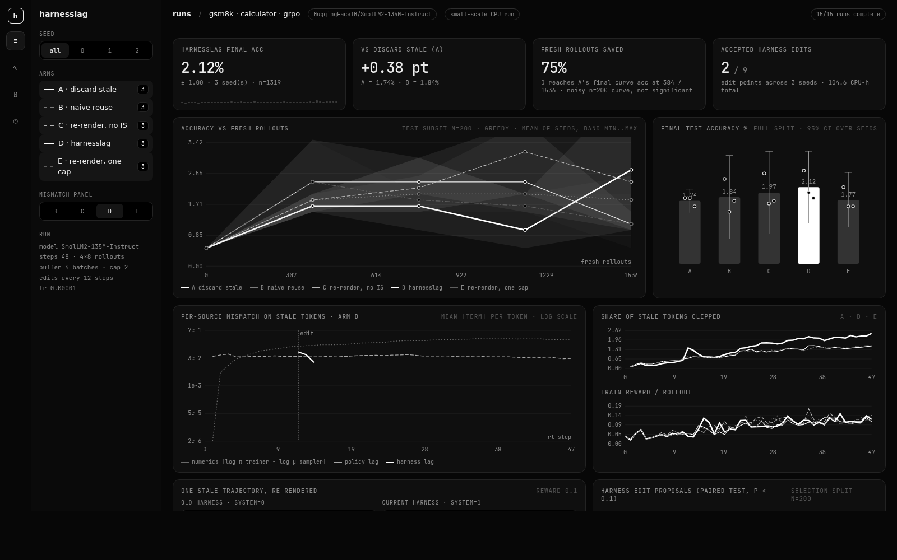
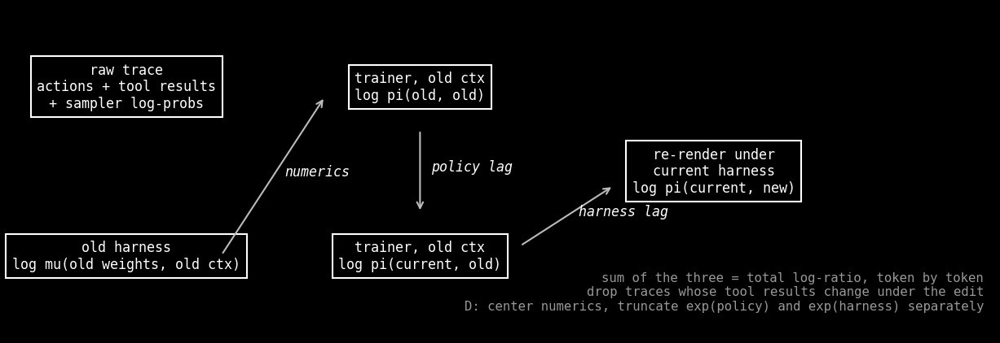
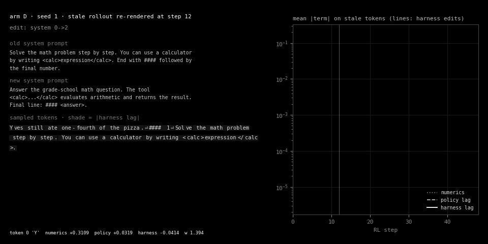
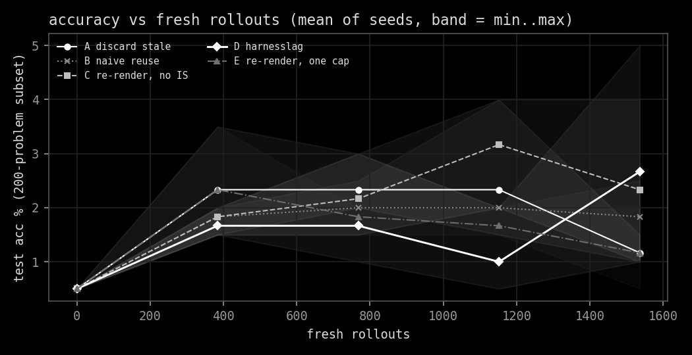
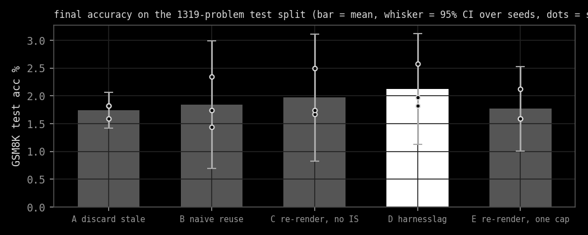
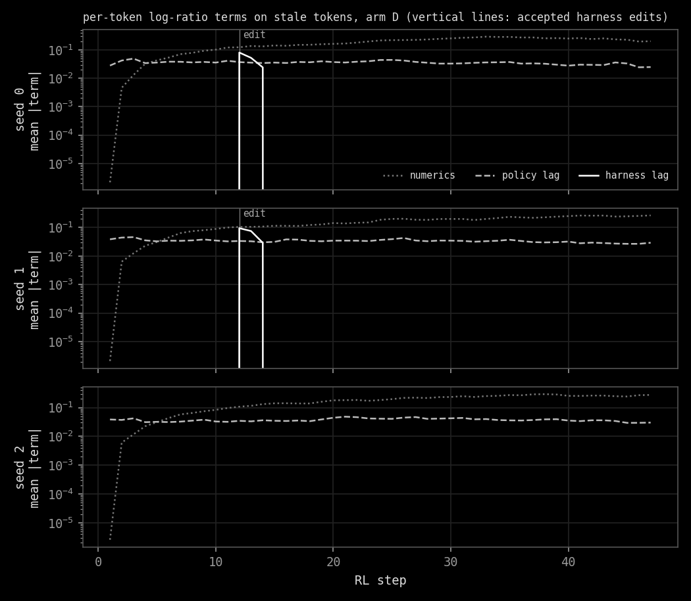

harnesslag reuses stale agent RL rollouts after the harness has changed. It stores every rollout as a raw trace,
re-renders it under the current harness, and splits each token's log-ratio exactly into three parts: engine
numerics, policy lag and harness lag. Each part gets its own truncated importance weight. A trace whose tool
results would change under the new harness is dropped.

[](LICENSE)
[](requirements.txt)
[](https://huggingface.co/HuggingFaceTB/SmolLM2-135M-Instruct)
[](https://arxiv.org/abs/2610.41073v1)
[](https://arxiv.org/abs/2610.10426v1)

`#ai-frontier-research` `#llm-agents` `#reinforcement-learning` `#grpo` `#agent-harness` `#importance-sampling` `#off-policy-rl` `#qwen`



Every number below comes from a **small-scale CPU run**: SmolLM2-135M-Instruct, 48 GRPO steps per run, 5 arms and
3 seeds on one 8-core machine. A 135M model is weak at GSM8K, so treat these runs as a working pipeline and a
measurement of the mismatch terms, not as evidence about accuracy at scale.

## The Split

An agent's harness covers the system prompt, how tool output is formatted, and the reminders it adds. When the
harness changes mid-training, the usual move is to throw away every rollout collected under the old one.
harnesslag keeps them. A rollout is stored as the sampled action tokens, the raw calculator results and the
sampler's log-probabilities. The context is never stored as text. It is rebuilt from the trace whenever needed.

For one stale action token the total log-ratio splits exactly:

```
log pi(current weights, new ctx) - log mu(old weights, old ctx)
  = [log pi(old, old)     - log mu(old, old)]       numerics: trainer fp32 vs sampler bf16 + KV cache
  + [log pi(current, old) - log pi(old, old)]       policy lag
  + [log pi(current, new) - log pi(current, old)]   harness lag
```

`test_harnesslag.py` checks that the three terms sum to the total to within 1e-4 on real SmolLM2 outputs. Arm D
centers the numerics term, treating it as a near-constant bias, then caps the exponential of each of the three terms
at 2 on its own. Arm E caps their product once instead.



## The Trace

The GIF shows one real stale rollout from arm D, first under the harness it was sampled with and then under the
harness that replaced it. Each sampled token is shaded by its harness-lag term. The curves on the right fill in
step by step, and the vertical lines mark accepted harness edits.



## The Arms

| arm | stale rollouts | context | correction |
|---|---|---|---|
| A discard stale | dropped after a harness edit | same harness only | one truncated weight on the total ratio |
| B naive reuse | kept | old harness | none |
| C re-render, no IS | kept | current harness | none |
| D harnesslag | kept | current harness | centered numerics, separate caps per source |
| E re-render, one cap | kept | current harness | one combined cap |

Each step samples 4 GSM8K train problems with 8 completions each and trains on a replay buffer that holds the last
4 batches. Arm A proposes single-component harness edits every 12 steps and accepts the best one if a paired t-test
on 200 held-out train problems gives p < 0.1. Arms B to E replay the edits that arm A accepted for the same seed,
so every arm of a seed sees the same harness schedule. One of the possible edits rounds calculator results, which
changes tool semantics. Traces with tool calls cannot be reused across that edit and are dropped.

## The Results

Final accuracy is on the full 1,319-problem GSM8K test split, greedy decoding, mean and 95% CI over 3 seeds.

<!-- results:start -->
| arm | final test acc (mean ± 95% CI) | per seed | stale tokens clipped | dropped non-renderable | CPU-hours |
|---|---|---|---|---|---|
| A discard stale | 1.74 ± 0.33 | 1.82, 1.82, 1.59 | 1.02% | 0 | 23.9 |
| B naive reuse | 1.84 ± 1.15 | 2.35, 1.44, 1.74 | n/a (no IS) | 0 | 20.1 |
| C re-render, no IS | 1.97 ± 1.15 | 2.50, 1.67, 1.74 | n/a (no IS) | 0 | 19.8 |
| D harnesslag | 2.12 ± 1.00 | 2.58, 1.97, 1.82 | 1.37% | 0 | 20.4 |
| E re-render, one cap | 1.77 ± 0.76 | 2.12, 1.59, 1.59 | 1.02% | 0 | 20.4 |
<!-- results:end -->

What these small-scale runs show:

- **No accuracy claim survives.** D (harnesslag) has the highest mean, 2.12%, against 1.74% for A. The gap is
  +0.38 points, about 5 problems out of 1,319. D beats A on every seed, but the paired t-test over 3 seeds gives
  p = 0.19, and every arm's 95% CI overlaps every other's. D against E (one combined cap) is the only paired
  comparison under p = 0.05 (p = 0.03). That is one of four comparisons on 3 seeds, so it is a hint, not a finding.
- **The 75% "rollouts saved" figure on the dashboard is noise.** It is computed on a 200-problem test subset
  evaluated every 12 steps. A's curve peaks early and falls back to 1.17% by the end, so D "matches" it after the
  first eval.
- **Numerics dominates the split.** On stale tokens the mean |term| is 0.16 to 0.20 nats for numerics, 0.03 to
  0.06 for policy lag, and about 0.1 for harness lag right after an edit. Harness lag vanishes once pre-edit
  batches leave the 4-batch buffer, 3 steps later. Numerics starts near 1e-6: the checkpoint is bf16, so the bf16
  sampler copy is exact at first. It grows as fp32 updates move the trainer's weights off the bf16 grid.
- **The calculator was almost never called.** Fewer than 0.2% of rollouts use it, the rounding edit was never
  accepted, and no trace was dropped as non-renderable. The semantic-edit path is covered by the tests but was
  not exercised in these runs.
- Arm A accepted an edit at 2 of its 9 edit points (3 per seed). Both were system-prompt swaps (seeds 0 and 1). Seed 2 accepted none, so
  its C and B runs are the same algorithm and reached the same accuracy. Total compute: 104.6 CPU-hours.

| | |
|---|---|
|  |  |
|  |  |

The full write-up, including what failed, is in [docs/REPORT.md](docs/REPORT.md).

## The Screen

`make figures` regenerates the plots, the README table and `dashboard/index.html` from `results/*.json`. The
dashboard is a single static file with no server. Open it in a browser, then filter by seed and by arm, switch the
mismatch panel between arms, and read one stale trajectory token by token.

## The Scale

`scripts/full_scale_gpu.sh` is the full experiment: Qwen2.5-0.5B-Instruct, 150 steps, edits every 25 steps, 5 arms
and 3 seeds on one 24 GB GPU. It times 5 steps first and asks before launching all 15 runs. It has not been run.

## Install

```sh
git clone https://github.com/Sebastianrodaaa/harnesslag && cd harnesslag
python3 -m venv .venv && . .venv/bin/activate
pip install torch==2.14.1 --index-url https://download.pytorch.org/whl/cpu
pip install -r requirements.txt
python3 test_harnesslag.py          # dry run: exactness, rendering, one RL step per arm
make repro ARM=D SEED=0             # one real run
make all-cpu                        # all 15 small-scale runs, then make figures
```

GSM8K is written to `data/`, models go to the Hugging Face cache (`~/.cache/huggingface`) and results go to
`results/`. To undo, delete the clone, the virtualenv and the two cached models.

## The Name

Harness lag is the gap between the harness a rollout was sampled under and the one you train under now. It is the
third kind of lag, after the two that RL stacks already correct.

## Inspirations

The exact numerics/policy-lag split comes from recent work on training-inference mismatch. Harness co-evolution
comes from HarnessAdapt-RL, WHALE and CoTrace, and the paired-test edit gate comes from TinyAstral. The README
shape comes from athanor. See [INSPIRATIONS.md](INSPIRATIONS.md).

## License

MIT, see [LICENSE](LICENSE). GSM8K, the models, the Dürer plates and the font are credited in
[NOTICE.md](NOTICE.md).

## Citation

```bibtex
@software{harnesslag2026,
  title  = {harnesslag: importance-corrected reuse of stale agent RL rollouts across harness edits},
  author = {Roda, Sebastian},
  year   = {2026},
  url    = {https://github.com/Sebastianrodaaa/harnesslag}
}
```
